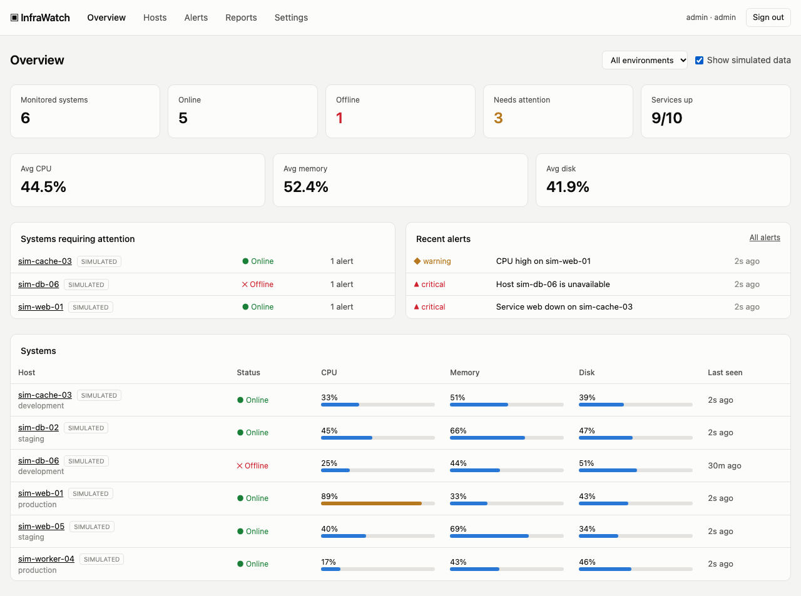
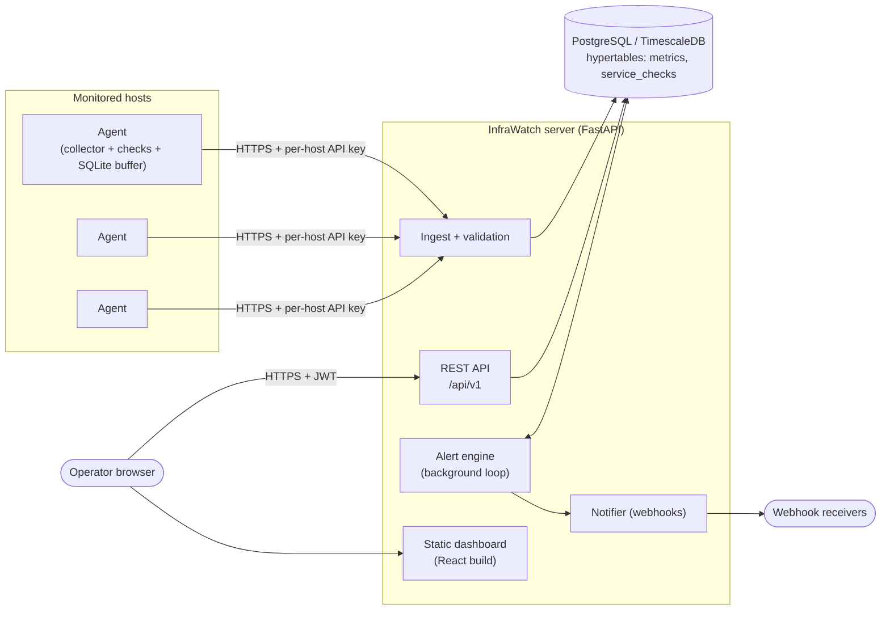
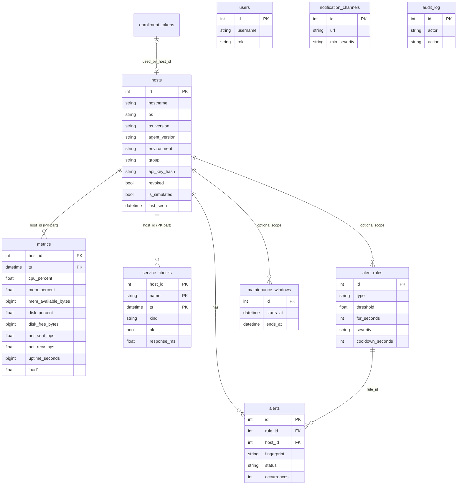

# InfraWatch

Infrastructure monitoring platform: a central **FastAPI server** with a React dashboard, plus a lightweight
**Python agent** that reports system metrics and service health from authorized hosts.



> Screenshots use **simulated** data (clearly labelled `SIMULATED` in the UI and hidden by default).
> A host is only counted as monitored after its agent has successfully communicated with the server.

## Features

| Area | What's implemented |
|---|---|
| Metrics | CPU, memory (% and available), disk (% and free), network throughput, uptime, load averages (where the OS supports them), hostname / OS / OS version / agent version / last communication |
| Service checks | HTTP (status + response time), TCP port, process-by-name; per-service availability %, failure counts, history |
| Dashboard | Totals, online/offline/pending, systems needing attention, charts (hover crosshair + table view), time ranges (15m-30d), environment/group/status/search filters, host detail pages, historical report, CSV/JSON export |
| Alerting | Rules for CPU / memory / low disk / host down / service down / slow response; severities; sustained-condition windows; ack / resolve / history; duplicate suppression; cooldown; maintenance windows; webhook notifications |
| Agent | YAML config with strict validation, configurable interval, HTTPS (TLS verification can't be disabled), retries with exponential backoff + jitter, durable SQLite buffer, JSON logs, graceful shutdown, health file, `check`/`validate`/`status` commands |
| Security | One-time enrollment tokens, per-host API keys (identity derived from key, never payload), RBAC (viewer / operator / admin), Argon2id passwords, JWT sessions, rate limiting, strict input validation, audit log, security headers. See [SECURITY.md](SECURITY.md) |
| Platform | Docker Compose with PostgreSQL/TimescaleDB, GitHub Actions CI, simulator for demo data |

## Architecture



### Agent-to-server communication

```mermaid
sequenceDiagram
  participant Admin
  participant Agent
  participant Server
  Admin->>Server: POST /enrollment-tokens (admin JWT)
  Server-->>Admin: iwe_... (shown once, expiring, single use)
  Admin->>Agent: token via env var
  Agent->>Server: POST /agents/register (Bearer token, host info)
  Server-->>Agent: host_id + API key iw_<id>_<secret> (shown once; only SHA-256 stored)
  Note over Agent: key saved to state_dir/agent.key (0600)
  loop every interval
    Agent->>Agent: collect metrics + run checks, append to SQLite buffer
    Agent->>Server: POST /agents/metrics (Bearer API key, batch of samples)
    alt 200
      Server-->>Agent: accepted/duplicates/rejected counts
      Agent->>Agent: delete acknowledged samples
    else network error / 5xx / 429
      Note over Agent: keep samples, exponential backoff + jitter
    else 401
      Note over Agent: keep samples, log "credentials rejected"
    else 4xx (invalid)
      Note over Agent: drop poison batch so it can't block the queue
    end
  end
```

Replays are safe: samples are keyed by `(host_id, ts)`, so re-sent batches are counted as duplicates.

### Database ERD



`metrics` and `service_checks` have composite primary keys that include `ts`, which makes them valid
TimescaleDB hypertables. On startup the server runs `create_hypertable` when the extension exists and falls back to
plain PostgreSQL tables otherwise. Old rows are purged after `INFRAWATCH_METRIC_RETENTION_DAYS` (30).

## Quick start (Docker Compose)

```bash
cp .env.example .env          # set POSTGRES_PASSWORD, INFRAWATCH_SECRET_KEY, INFRAWATCH_ADMIN_PASSWORD
docker compose up -d --build
open http://localhost:8000    # log in as admin / your INFRAWATCH_ADMIN_PASSWORD
```

For HTTPS: `docker compose --profile tls up -d` (Caddy on :443; see `deploy/Caddyfile`) and set
`INFRAWATCH_TRUST_PROXY_HEADERS=true`. Don't expose plain-HTTP port 8000 beyond localhost in production.

## Quick start (local, no Docker; SQLite)

```bash
python3 -m venv .venv && source .venv/bin/activate
pip install -e server -e agent
(cd frontend && npm ci && npm run build)
export INFRAWATCH_ADMIN_PASSWORD='choose-a-password' INFRAWATCH_SECRET_KEY="$(python -c 'import secrets;print(secrets.token_urlsafe(48))')"
uvicorn --factory infrawatch_server.main:app_factory --port 8000
```

Demo data: `python -m infrawatch_server.simulate --hosts 8 --hours 24` creates flagged **simulated** hosts, metrics and
alerts (`--purge` removes them). They are hidden unless "Show simulated data" is ticked, and they can never be
authenticated as, so no agent can write into them.

Frontend dev server with hot reload: `cd frontend && npm run dev` (proxies `/api` to :8000).

## Installing an agent

1. In the dashboard: **Settings → Enrollment tokens → Create token** (choose environment/group). Copy the token; it is shown once and expires.
2. On the monitored host (Python 3.10+):
   ```bash
   python3 -m venv /opt/infrawatch-agent && /opt/infrawatch-agent/bin/pip install ./agent
   sudo mkdir -p /etc/infrawatch && sudo cp deploy/agent.example.yaml /etc/infrawatch/agent.yaml   # edit server_url, checks
   export INFRAWATCH_ENROLLMENT_TOKEN=iwe_...
   /opt/infrawatch-agent/bin/infrawatch-agent -c /etc/infrawatch/agent.yaml register
   /opt/infrawatch-agent/bin/infrawatch-agent -c /etc/infrawatch/agent.yaml check    # verifies credentials
   ```
3. Run it as a service: `deploy/infrawatch-agent.service` (hardened systemd unit), or `infrawatch-agent -c agent.yaml run`.

The host shows as **Pending** until its first successful report, then **Online**. If nothing is heard for
`INFRAWATCH_OFFLINE_AFTER_SECONDS` (90 s) it becomes **Offline**.

Agent commands: `run`, `register`, `check`, `validate`, `status` (reads `health.json`).

## Configuration reference (server)

All settings are environment variables prefixed `INFRAWATCH_` (see `server/infrawatch_server/config.py`):
`DATABASE_URL`, `SECRET_KEY`, `ADMIN_USERNAME`, `ADMIN_PASSWORD`, `TOKEN_TTL_MINUTES`, `OFFLINE_AFTER_SECONDS`,
`EVALUATION_INTERVAL_SECONDS`, `METRIC_RETENTION_DAYS`, `RATE_LIMIT_*_PER_MIN`, `LATEST_AGENT_VERSION`,
`ALLOW_PRIVATE_WEBHOOKS`, `TRUST_PROXY_HEADERS`, `CORS_ORIGINS`.

## Alert behaviour

* **Rules**: `cpu_high`, `mem_high` (percent above threshold), `disk_low` (free % below threshold), `host_down`,
  `service_down`, `response_slow` (ms above threshold). Scope by host, environment or group. `for_seconds` requires
  the condition to hold continuously (e.g. CPU > 90 % for 5 min).
* **Lifecycle**: `open → acknowledged → resolved`. Alerts auto-resolve when the condition clears; operators can resolve manually. History is kept.
* **Storm prevention**: one live alert per rule+host+service (repeat triggers only increment `occurrences`);
  per-rule **cooldown** after resolution blocks flapping re-opens; **maintenance windows** suppress new alerts;
  one notification on open and one on resolve, never per evaluation.
* **Notifications**: JSON webhooks with minimum severity per channel. Delivery failures are logged and never block evaluation.

## API

Interactive docs at `/api/docs` (OpenAPI). Summary and examples in [docs/API.md](docs/API.md).

## Testing

```bash
pip install -e "server[dev]" -e "agent[dev]"
pytest server/tests            # API, auth, RBAC, ingestion, alert engine
pytest agent/tests             # collector, config validation, buffer, retry/backoff
pytest tests/integration       # real agent <-> real uvicorn server, incl. TLS, outage + reconnect
cd frontend && npm ci && npx playwright install chromium && npx playwright test   # dashboard E2E (builds on a seeded server)
```

Set `INFRAWATCH_TEST_DATABASE_URL=postgresql://…` to run the server suite against PostgreSQL (CI does this).

## Status and known limitations

Be aware of what is and isn't verified (details in [docs/ROADMAP.md](docs/ROADMAP.md)):

* Server tests, agent tests, TLS integration tests and Playwright E2E run against **SQLite** in development. The
  PostgreSQL/TimescaleDB path and the Docker/Compose setup are provided and exercised by the CI workflow, but were not run on the
  machine this was authored on (no Docker there).
* Agents were exercised on macOS. Linux is expected to work; Windows has no load average and is untested ([docs/PLATFORMS.md](docs/PLATFORMS.md)).
* Chart queries average in Python over the selected window (capped at 90 days); for very large fleets move this to `time_bucket`/continuous aggregates.
* Rate limiting is in-process (per replica). Multi-tenancy, SSO/MFA and non-webhook notifiers are not implemented.

## Docs

[Contributing](CONTRIBUTING.md) · [Agent rules](AGENTS.md) · [Changelog](CHANGELOG.md) · [Security](SECURITY.md) · [API](docs/API.md) · [Platform notes](docs/PLATFORMS.md) · [Troubleshooting](docs/TROUBLESHOOTING.md) · [Roadmap](docs/ROADMAP.md)

## License

MIT, see [LICENSE](LICENSE).
